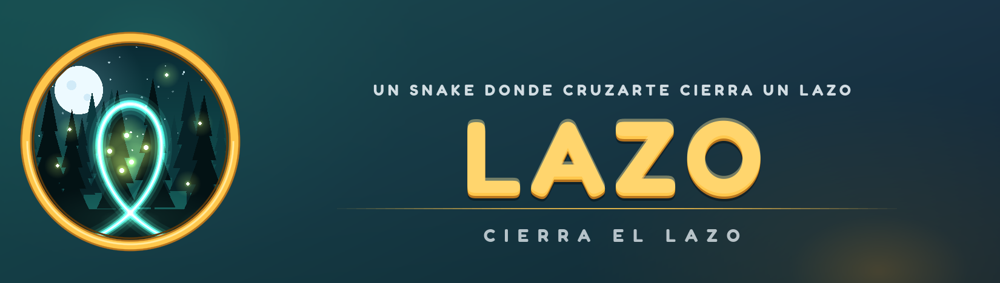

  

# Lazo

Hola 👋 Este es **Lazo**, un proyecto personal: un juego que se me ocurrió y que quiero hacer lo mejor posible.

Todo empezó con una pregunta simple: *¿y si en un Snake cruzarte contigo mismo no fuera tu error, sino tu mejor jugada?*
En Lazo manejas una cuerda de luz. Cuando la cruzas, cierras un **lazo** y atrapas todo lo que quede dentro.

## Cómo se juega

- Rodea a las luciérnagas con tu propia cuerda para atraparlas. Huyen de ti, así que hay que ser astuto.
- Cuanto más grande el lazo, más puntos y más cuerda ganas.
- Cuidado con los espinos y los escarabajos de sombra. Si los encierras en un lazo, los destruyes.
- Se puede jugar solo o en **coop local** de a dos: las dos cuerdas están unidas por una cuerda elástica, y si cerráis lazos a la vez, ¡sincro!

## Qué incluye hoy

- Mundo **Bosque** con 2 niveles (el primero de muchos).
- Tres dificultades: Fácil, Normal y Difícil.
- Teclado, ratón y mando (también PS5, Xbox y otros), con pantalla completa.
- Ajustes de volumen y actualizaciones desde el propio juego.

## Qué viene

Estoy construyendo más mundos, cada uno con su ambiente y su mecánica: Hielo, Desierto, Océano, Volcán y Neón,
con al menos 10 niveles por mundo y jefes en el camino. Lo voy puliendo poco a poco, con mucho cariño.

## Descargar

1. Ve a [**Releases**](../../releases/latest) y descarga `Lazo.exe`.
2. Ábrelo. No necesitas instalar nada más (Windows 10 / 11).
3. Si Windows muestra «Windows protegió su PC»: *Más información → Ejecutar de todas formas*. Es normal en juegos independientes que aún no están firmados.

Cuando salga una versión nueva, el juego te lo avisa en el menú y se actualiza solo.

## Controles

| | Jugador 1 | Jugador 2 |
|---|---|---|
| Teclado | `W` `A` `S` `D` (o flechas si juegas solo) | Flechas |
| Mando | Stick izquierdo o cruceta | Stick izquierdo o cruceta |

`Esc` o `Start` pausan · `F11` cambia pantalla completa.

## Créditos

Hecho con [Godot Engine](https://godotengine.org). Sonidos de [Kenney](https://kenney.nl) (CC0) y tipografía Fredoka (SIL OFL).
Más detalles en [THIRD_PARTY_LICENSES.txt](THIRD_PARTY_LICENSES.txt).

## Licencia

Lazo © 2026 G30vamv. Todos los derechos reservados. Puedes descargarlo y jugarlo libremente; no se permite copiarlo, redistribuirlo ni venderlo. Ver [LICENSE.txt](LICENSE.txt).

---

Gracias por pasarte por aquí y por jugar. Si te gusta, eso ya me motiva a seguir. 💚
